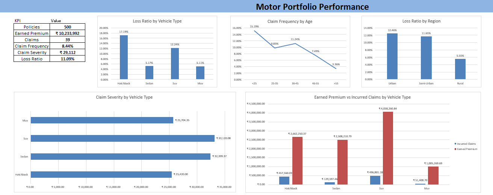

# Motor Insurance Claims Analysis & Pricing Model

## Project Overview

This project analyses a portfolio of 500 motor insurance policies using Microsoft Excel. It examines claims experience, compares portfolio segments, and develops a simplified indicative pricing model.

The project demonstrates the application of actuarial concepts to general insurance data.

## Objectives

- Analyse earned premium, incurred claims and exposure.
- Calculate claim frequency, claim severity and pure premium.
- Evaluate loss ratios across different portfolio segments.
- Build an indicative premium calculation model.
- Perform sensitivity analysis on claim frequency and severity.
- Present key findings through an Excel dashboard and executive summary.

## Tools Used

- Microsoft Excel
- Excel formulas and tables
- Pivot tables and charts
- Dashboard reporting
- Pricing and sensitivity analysis

## Portfolio Summary

| Metric | Result |
|---|---:|
| Number of policies | 500 |
| Number of claims | 39 |
| Total exposure | 461.824 policy-years |
| Earned premium | ₹10.23 million |
| Incurred claims | ₹1.14 million |
| Claim frequency | 8.44% |
| Average claim severity | ₹29,112 |
| Pure premium per policy-year | Approximately ₹2,458 |
| Portfolio loss ratio | 11.09% |

## Methodology

### 1. Claim Frequency

Claim frequency is calculated as:

Claim Frequency = Number of Claims / Total Exposure

Exposure is measured in policy-years to account for differences in the length of insurance coverage.

### 2. Claim Severity

Claim Severity = Total Incurred Claims / Number of Claims

This measures the average incurred cost per claim.

### 3. Pure Premium

Pure Premium = Claim Frequency × Claim Severity

This represents the expected claims cost per policy-year, before expenses and profit margins.

### 4. Loss Ratio

Loss Ratio = Incurred Claims / Earned Premium

This measures incurred claims relative to earned premium.

### 5. Indicative Pricing Model

Indicative Premium = Pure Premium / (1 − Expense Ratio − Profit Margin)

The model uses assumed expense and profit-margin percentages to illustrate how a technical premium can be adjusted for expenses and a target margin.

### 6. Sensitivity Analysis

The model evaluates different combinations of claim frequency and severity to understand how changes in claims experience affect the indicative premium.

## Key Findings

- Hatchback policies recorded a higher loss ratio than the other vehicle categories in this dataset.
- Drivers below age 25 showed a higher exposure-based claim frequency.
- Urban policies recorded a higher loss ratio than the overall portfolio.
- Vehicles aged 4–6 years showed a higher loss ratio than the other vehicle-age categories.

These findings describe this dataset and should not be treated as universal insurance-industry conclusions.

## Project Dashboard

The dashboard below summarises portfolio performance, claim frequency, claim severity and loss ratios across different segments.

## Project Files

- [Download the Excel Workbook](Motor_Insurance_Claims_Analysis.xlsx)
- [View Dashboard Screenshot](dashboard.png)

## Limitations

- The dataset is synthetic and intended for educational purposes.
- Expense ratio and profit margin are illustrative assumptions.
- The pricing model is simplified and does not include all real-world rating factors, credibility adjustments, risk loadings, regulatory considerations or insurer-specific expenses.
- Segment results are based on a relatively small portfolio and should be interpreted cautiously.

## Author

Actuarial student interested in general insurance, pricing, portfolio analytics and actuarial modelling.
